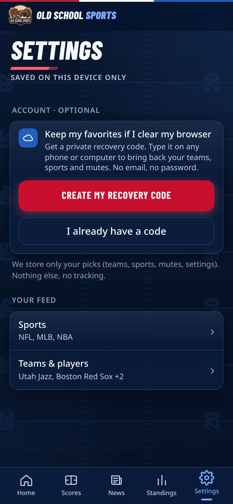
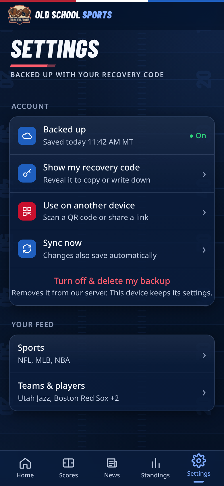
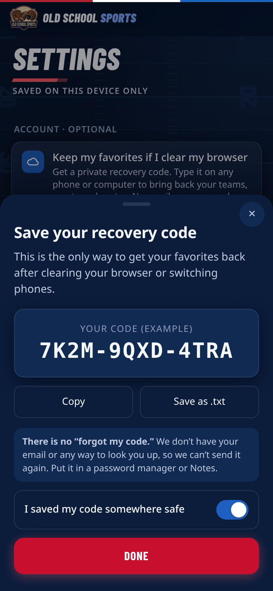
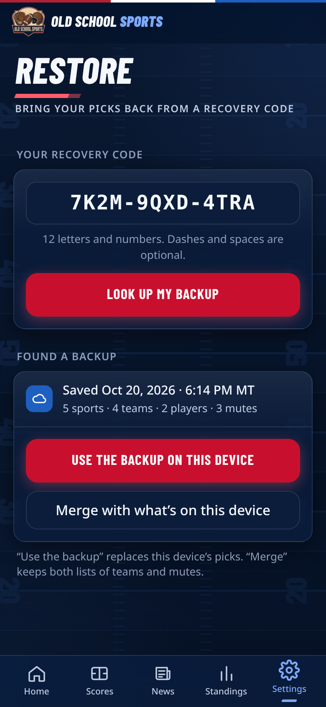
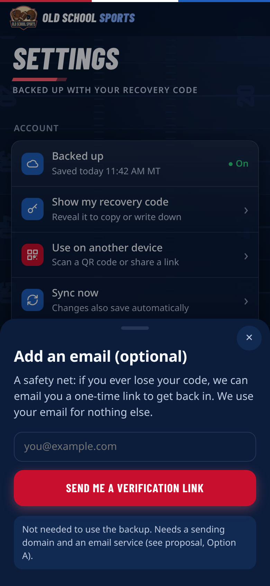

# Proposal: keep favorites after cache/cookies are cleared

**Status:** design proposal only. Nothing in this document is built or shipped in v1.3.0 "Pick Six".
**Author:** Grok Bot · **Date:** Wed Oct 28, 2026 (America/Denver) · **Requested by:** Justin
**Ask (verbatim):** "I'd like to have the account favorites stay for the users even if their cache and cookies are deleted. Can you create something like that and what would it look like?"

## 1. The short version

- Today everything lives in the browser (`localStorage` key `straightcfb.settings.v1`). Clear the browser data and the favorites are gone. A copy must live **somewhere that is not the browser**.
- **Recommendation: Option B, a "recovery code."** The user taps *Create my recovery code* once, gets something like `7K2M-9QXD-4TRA`, and can type it on any phone or computer to get their teams, sports, players and mutes back. No email, no password, no personal data collected.
- It needs a small server-side store. The cheapest workable one is **Neon Postgres Free ($0)**, called from the Express server that already runs on Render's free web service. **Expected cost to Justin: $0/month.**
- **Add email (Option A) later, only if wanted.** It adds a safety net for lost codes but costs a domain name (price not verified, varies by registrar) plus a free email service. **Skip passkeys/Apple/Google (Option C) for now.** They are the heaviest to build, and Apple costs $99/year.
- This release ships **only this proposal and the mockups**. No sync code is in the app.

## 2. What it would look like (390px mockups)

These are rendered from static HTML pages in `docs/mocks/` that reuse the app's real stylesheet. The code `7K2M-9QXD-4TRA` is an example, not a real code.

| Settings › Account, not signed in | Settings › Account, backed up | Save-your-code dialog | Restore from code |
|---|---|---|---|
|  |  |  |  |

Optional later (Option A add-on): 

Files: `docs/mocks/account-{signed-out,signed-in,save-code,restore,email-later}.{html,png}` and `screenshots/v19/mock-account-*.png`. Regenerate with `node scripts/make-account-mocks.js`.

**Flow in words (Option B)**
1. Settings › Account › **Create my recovery code**. The server makes a random code and saves the user's picks under it.
2. The dialog shows the code with **Copy** and **Save as .txt** buttons and a clear "there is no forgot-my-code" warning. *Done* is enabled only after the user ticks "I saved my code."
3. From then on, changes save automatically (debounced) and the card shows "Backed up · saved today 11:42 AM MT."
4. After clearing the browser or switching phones: Settings › **I already have a code** › type it › the app shows what it found (counts and the last-saved date) › **Use the backup on this device** (replace) or **Merge with what's on this device**.
5. **Turn off & delete my backup** deletes the server copy.

## 3. The technical constraint (checked against official docs, Oct 28, 2026)

The app runs on a Render **free web service**. Render's docs say its filesystem is ephemeral: changes are lost on every redeploy, restart or spin-down, and free web services cannot attach a persistent disk. Storing prefs in the repo is not acceptable. So a separate persistent store is required.

### Storage options

| Store | Free tier, per its own docs | Fit |
|---|---|---|
| **Render persistent disk** | Needs a **paid** web service plus **$0.25/GB/month** for the disk. Adding a disk also disables zero-downtime deploys. Free web services can't use disks. | Works, but turns a $0 app into a paid one (cheapest compute shown is $7/month, so about $7.25/month minimum with 1 GB). Single-instance only. Not recommended. |
| **Render Postgres Free** | 1 GB, **expires 30 days after creation**, 14-day grace, then deleted. No backups. One free DB per workspace. | **Not viable.** Would destroy users' backups every month. |
| **Render Key Value Free** | In-memory only. All data lost on restart. | **Not viable.** |
| **Neon Postgres Free** | Permanent (not a trial), no card. 1 GB Postgres storage per project (20 GB per account), 100 CU-hours/project/month, scales to zero after 5 minutes of inactivity (can't be turned off on Free), 5 GB egress. Hitting a limit suspends compute or blocks writes; **docs say none of these delete data**. 6-hour history window. | **Best fit.** Real Postgres, $0, plenty of room. Cost of scale-to-zero: the first request after idle has a cold start (the app's own Render free service already spins down after 15 idle minutes, so the first-load wait is already there). |
| **Turso Free** | 100 databases, 5 GB storage, 500M rows read and 10M rows written per month. SQLite-style. | **Good alternate.** More headroom than Neon, no scale-to-zero cold start mentioned on the pricing page. Different client library. |
| **Supabase Free** | 500 MB database, 2 active projects, **projects pause after 1 week of inactivity**. | Poor fit. A rarely-used backup store would pause, and restore is exactly the moment you need it. |
| **Cloudflare Workers KV Free** | 1 GB stored; 100,000 reads/day; **1,000 writes/day**; 1,000 deletes/day. Limits reset daily 00:00 UTC; over the limit, operations fail. | Works for a small user base, but the 1,000 writes/day cap is the tightest limit and would bite if the app grows. Not recommended as the primary store. |

Sources (all opened Oct 28, 2026): render.com/docs/free · render.com/docs/disks · render.com/pricing · neon.com/pricing · turso.tech/pricing · supabase.com/pricing · developers.cloudflare.com/kv/platform/pricing

**Free-tier risk, stated plainly:** free tiers can change. Mitigation: the app stays local-first (the browser copy is always the working copy), the profile is a small JSON document that is easy to export and move to another database, and Settings keeps an *Export/Import JSON* escape hatch.

**Capacity estimate (my arithmetic, not a vendor number):** one profile is a few KB of JSON, so 1 GB holds on the order of 100,000+ profiles.

## 4. The three options

### Option A: Email magic link
- **Flow:** enter email › receive link › tap it › signed in on that device. New device: same.
- **Stores:** email address (this is PII) plus the prefs.
- **Privacy:** worst of the three: we would hold an address per user and need an unsubscribe/delete story.
- **What it needs:** a transactional email service, and a **domain you own**. Resend's docs: "You must add and verify at least one domain to send emails." Also, Render free web services **block outbound SMTP ports 25/465/587**, so email must go through an HTTPS API (Resend and Brevo both have one).
- **Free email options:** Resend Free: $0, **3,000 emails/month, 100/day**, 3 domains. Brevo Free: up to **300 emails/day** after account approval. Either covers magic links for a long time.
- **Effort (my estimate):** 1.5–2 days: tokens, expiry, email template, deliverability setup (SPF/DKIM DNS records), abuse limits.
- **Cost:** $0 for the email service + the **cost of a domain name (not verified; varies by registrar)**.
- **Upside:** familiar; recoverable if the user forgets. **Downside:** domain, DNS, deliverability, PII.

### Option B: Recovery code / sync key (recommended)
- **Flow:** see section 2. Optional later: show the code as a QR or a one-time link for "use on another device."
- **Stores:** only the prefs plus timestamps. No name, no email, no IP address kept.
- **Privacy:** best of the three. The server knows nothing about who the user is. (Optional hardening: encrypt the profile in the browser with a key derived from the code, so even the database owner can't read the picks. The picks aren't sensitive, so this is optional.)
- **Effort (my estimate):** about 1 day for server + about 1 day for UI, tests and QA.
- **Cost:** **$0/month** (Neon Free + the existing Render free web service).
- **Downside:** if the user loses the code, it can't be recovered (there is nothing to look up). The dialog is blunt about this and gates *Done* behind a checkbox. The email add-on (A) is the later fix for that.
- **Code design:** 12 random characters from Crockford Base32 (no I, L, O, U, so it's hard to mistype), about 60 bits of randomness, shown as `XXXX-XXXX-XXXX`. Input accepts any case, dashes or spaces.

### Option C: Passkey / Sign in with Apple / Google
- **Passkey (WebAuthn):** the phone/computer keeps the credential; iCloud Keychain / Google Password Manager sync it. Survives clearing the browser (a real plus). Still needs the same server store, plus WebAuthn server code and a fallback when a passkey isn't available. **Effort (my estimate): 3+ days.** **Cost:** $0 beyond the store.
- **Sign in with Apple:** the Apple Developer Program is **$99 per membership year** (developer.apple.com/programs/whats-included). Needs an Apple Services ID and key setup.
- **Sign in with Google:** needs a Google Cloud project and an OAuth consent screen. I did not verify Google's current terms for this, so I'm not quoting a price.
- **Privacy:** the provider learns the user signs in to the app; we'd store a provider user id (and possibly an email).
- **Verdict:** best polish, highest effort and lowest privacy for a hobby app. Not now.

### Comparison

| | A: Email link | **B: Recovery code** | C: Passkey / Apple / Google |
|---|---|---|---|
| Survives clearing browser data | Yes | **Yes** | Yes |
| Lost-credential recovery | Yes (email) | **No** (unless A added later) | Platform handles it |
| Personal data we hold | Email | **None** | Provider id (+ maybe email) |
| Build effort (estimate) | 1.5–2 days | **~2 days** | 3+ days |
| Running cost | Domain + $0 email tier | **$0** | $0, or $99/yr for Apple |
| Extra accounts to create | Domain, email service | **Neon** | Neon, + Apple/Google |

## 5. Recommendation

1. **Ship B (recovery code) first**, backed by **Neon Free** (Turso as the fallback). Cost: **$0/month**. Time: about 2 days. No personal data.
2. **Later, optional:** add an email address as an *optional recovery method* for the same profile (Option A's pipeline: buy a domain, Resend Free). This fixes B's one weakness without making email mandatory.
3. **Don't build C now.**

## 6. What gets stored

Synced (from settings schema v6): `sports`, `sportsChosen`, `sport`, `players`, `muteUnselected`, `conferences`, `follow`, `muteTeams`, `muteLeagues`, `muteKeywords`, `sources`, `straightOnly`, `sportOnly`, `theme`, `watch.providers`.
Not synced: `onboarded` and anything cache-like (scores, news, images).
Never stored: names, emails, IP addresses, device ids, analytics, reading history.

### Data model (Postgres)

```sql
create table profiles (
  id          text primary key,          -- HMAC-SHA256(server pepper, normalized code), hex. The code itself is never stored.
  data        jsonb  not null,           -- the synced settings, schema-versioned (data.v)
  rev         integer not null default 1,-- bumps on every write; used for conflict detection
  created_at  timestamptz not null default now(),
  updated_at  timestamptz not null default now(),
  last_read_at timestamptz not null default now()
);
create index on profiles (last_read_at);   -- for the inactivity purge
```
Limits: `data` ≤ 32 KB; purge profiles with no read/write for 12 months (the card says so).

### API sketch (all JSON over HTTPS, no cookies)

| Method & path | Body / headers | Result |
|---|---|---|
| `POST /api/sync` | `{ data }` | Creates a profile. Returns `{ code, rev }`. The code is shown once and never stored. |
| `POST /api/sync/lookup` | `{ code }` | `{ summary: {sports, teams, players, mutes}, updatedAt }`, no full payload until the user confirms. |
| `GET /api/sync/profile` | `Authorization: Sync <code>` | `{ data, rev, updatedAt }` |
| `PUT /api/sync/profile` | `Authorization: Sync <code>`, `If-Match: <rev>`, `{ data }` | `{ rev }`, or `409 { data, rev }` on conflict |
| `DELETE /api/sync/profile` | `Authorization: Sync <code>` | `204`; deletes the row |

**Conflicts:** on `409` the client merges (union of teams, players, mutes and keywords; for single-value settings the most recent device wins) and retries once. "Use the backup" simply replaces.
**Offline-first:** local storage stays the working copy; sync is debounced (about 3 s after the last change) and best-effort.

## 7. Security notes

- **Hash at rest:** the database holds only `HMAC-SHA256(pepper, code)`. The pepper is a server env var (set in Render, never committed). A database leak alone can't be turned back into codes.
- **Brute force:** 60-bit codes plus rate limits make guessing impractical. Planned limits: lookups and failed attempts per IP (for example 10/min and 30 failed/hour), uniform "not found" responses with no timing difference, and a global create limit.
- **No PII:** no email, no IP stored or logged against a profile. Request logs rotate and don't include the Authorization header.
- **Transport:** HTTPS only (Render provides TLS). The code travels in a header, never in a URL or query string.
- **Abuse:** payload size cap, schema validation (allow-list keys, drop unknown), per-IP create cap.
- **Code sharing:** anyone with the code can read and edit the picks. That's the whole threat, and the data is low-sensitivity. A *rotate code* action can be added so a leaked code can be replaced.
- **Deletion:** one tap deletes the row. Inactive profiles are purged after 12 months.
- **Secrets:** `DATABASE_URL` and the pepper live only in Render's environment variables.

## 8. What it would cost Justin

| Item | One-time | Monthly |
|---|---|---|
| Option B on Neon Free + existing Render free web service | $0 | **$0** |
| Option B if a free tier is ever outgrown (Neon Launch is pay-as-you-go: $0.106/CU-hour, $0.35/GB-month) | — | small, usage-based |
| Option A add-on: domain name | not verified (varies) | — |
| Option A add-on: Resend Free (3,000/month, 100/day) or Brevo Free (300/day) | $0 | $0 |
| Option C: Sign in with Apple | — | $99/year |
| *Rejected:* Render paid compute + 1 GB disk | — | about $7.25 (compute $7 + $0.25/GB) |

Accounts Justin would need to create: a Neon account (free, no card). Nothing else for Option B.

## 9. Proposed rollout (if approved)

1. v1.4.0: server `/api/sync/*`, Neon connection, rate limits, unit tests, Account card + save/restore UI, stale-client and offline tests.
2. Justin adds two Render environment variables: `DATABASE_URL` (from Neon) and `SYNC_PEPPER` (random 32+ bytes). I would not see or print either.
3. Later, optional: email recovery (Option A) and QR/link device handoff.

## 10. Open questions for Justin

- OK to proceed with B on Neon Free?
- Is "if you lose the code, it's gone" acceptable at launch, or should email recovery ship alongside it?
- Purge inactive backups after 12 months: OK?
